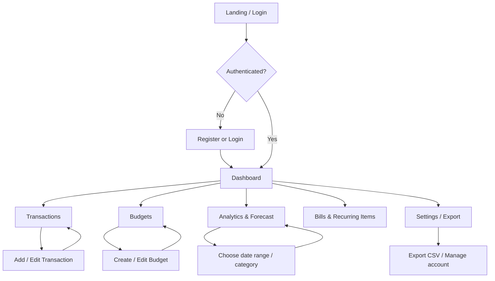

# Application Flow

## 1. High-level navigation

## 2. First-time user journey
1. Open the app and register.
2. Land on an onboarding panel explaining data privacy and the dashboard.
3. Add opening balance (optional).
4. Add the first income and expenses, or import a CSV.
5. Review suggested categories and correct any errors.
6. Set monthly budgets and alert thresholds.
7. View the dashboard and forecast; if history is limited, show a clear “add more transactions” state.

## 3. Add transaction flow
1. Select **Add transaction**.
2. Choose income, expense, bill, savings contribution, or debt payment.
3. Enter amount, date, category, account, merchant, and optional note.
4. If enabled, show a category suggestion and confidence.
5. Validate amount, date, ownership, and category.
6. Save and update dashboard totals.
7. Evaluate budget thresholds and create an alert only when a threshold is crossed.

## 4. Forecast flow
1. User selects month/horizon.
2. API loads eligible historical transactions.
3. Analytics service aggregates monthly spending.
4. If data is insufficient, return a baseline with an explicit low-confidence explanation.
5. Otherwise compare a simple rolling average with a seasonal or regression baseline.
6. Return forecast value, uncertainty interval (if supportable), method, and historical window.
7. UI labels forecast as an estimate and shows the historical trend.

## 5. Error and empty states
- No transactions: explain how to add one or import CSV.
- No forecast history: show “Add at least a few months of data for a more useful estimate.”
- CSV validation errors: show row number and reason; allow the user to cancel before import.
- API/network failure: preserve form input and offer retry.
- Unauthorized resource: return a generic not-found/forbidden response without exposing another user's data.

## 6. Key navigation items
Dashboard · Transactions · Budgets · Bills · Insights · Settings
