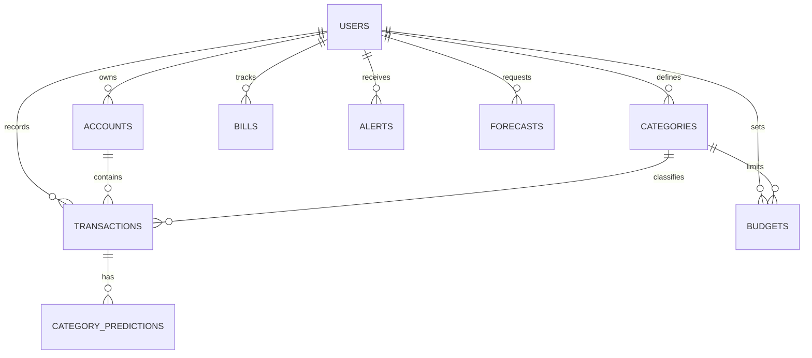

# Backend Database Schema

## 1. Modeling principles
- Use UUID primary keys.
- Use `NUMERIC(12,2)` for currency amounts.
- Store transaction date separately from creation/update timestamps.
- Every user-owned row must be scoped by `user_id`.
- Keep category, transaction type, and account relationships explicit.
- Store the currency code with each account or transaction where needed.

## 2. Entity relationship diagram

## 3. Tables

### `users`
| Column | Type | Rules |
|---|---|---|
| id | UUID | PK |
| email | VARCHAR(255) | unique, not null |
| password_hash | VARCHAR(255) | not null |
| display_name | VARCHAR(100) | not null |
| default_currency | CHAR(3) | default `INR` |
| created_at | TIMESTAMPTZ | not null |
| updated_at | TIMESTAMPTZ | not null |

### `accounts`
| Column | Type | Rules |
|---|---|---|
| id | UUID | PK |
| user_id | UUID | FK users.id, indexed |
| name | VARCHAR(100) | not null |
| account_type | VARCHAR(30) | cash, bank, wallet, credit_card |
| currency | CHAR(3) | not null |
| opening_balance | NUMERIC(12,2) | default 0 |
| is_archived | BOOLEAN | default false |
| created_at | TIMESTAMPTZ | not null |

### `categories`
| Column | Type | Rules |
|---|---|---|
| id | UUID | PK |
| user_id | UUID nullable | FK users.id; null means system category |
| name | VARCHAR(80) | not null |
| category_type | VARCHAR(20) | income, expense, bill, savings, debt |
| color | CHAR(7) | hex color |
| icon | VARCHAR(50) | optional |
| is_system | BOOLEAN | default false |
| created_at | TIMESTAMPTZ | not null |

Unique rule: `(user_id, name, category_type)` where supported by the chosen DB.

### `transactions`
| Column | Type | Rules |
|---|---|---|
| id | UUID | PK |
| user_id | UUID | FK users.id, indexed |
| account_id | UUID | FK accounts.id |
| category_id | UUID | FK categories.id |
| transaction_type | VARCHAR(20) | income, expense, bill, savings, debt, transfer |
| amount | NUMERIC(12,2) | greater than 0 |
| currency | CHAR(3) | not null |
| transaction_date | DATE | not null, indexed |
| merchant | VARCHAR(160) | optional |
| note | TEXT | optional |
| source | VARCHAR(20) | manual, csv, recurring |
| external_hash | VARCHAR(64) | optional duplicate-detection key |
| created_at | TIMESTAMPTZ | not null |
| updated_at | TIMESTAMPTZ | not null |

### `budgets`
| Column | Type | Rules |
|---|---|---|
| id | UUID | PK |
| user_id | UUID | FK users.id |
| category_id | UUID nullable | FK categories.id; null means overall budget |
| period_start | DATE | first day of budget period |
| period_end | DATE | last day of budget period |
| limit_amount | NUMERIC(12,2) | greater than 0 |
| alert_threshold_pct | SMALLINT | default 80; 1–100 |
| created_at | TIMESTAMPTZ | not null |
| updated_at | TIMESTAMPTZ | not null |

### `bills`
| Column | Type | Rules |
|---|---|---|
| id | UUID | PK |
| user_id | UUID | FK users.id |
| category_id | UUID nullable | FK categories.id |
| name | VARCHAR(120) | not null |
| expected_amount | NUMERIC(12,2) | greater than 0 |
| due_date | DATE | not null |
| recurrence | VARCHAR(20) | once, weekly, monthly, yearly |
| status | VARCHAR(20) | upcoming, paid, overdue, cancelled |
| account_id | UUID nullable | FK accounts.id |
| created_at | TIMESTAMPTZ | not null |

### `alerts`
| Column | Type | Rules |
|---|---|---|
| id | UUID | PK |
| user_id | UUID | FK users.id |
| budget_id | UUID nullable | FK budgets.id |
| alert_type | VARCHAR(30) | budget_threshold, budget_exceeded, unusual_spend, bill_due |
| title | VARCHAR(160) | not null |
| message | TEXT | not null |
| severity | VARCHAR(20) | info, warning, critical |
| dedupe_key | VARCHAR(180) | unique per user where applicable |
| is_read | BOOLEAN | default false |
| created_at | TIMESTAMPTZ | not null |

### `category_predictions`
| Column | Type | Rules |
|---|---|---|
| id | UUID | PK |
| transaction_id | UUID | FK transactions.id |
| suggested_category_id | UUID | FK categories.id |
| model_version | VARCHAR(50) | not null |
| confidence | NUMERIC(5,4) | 0–1 |
| accepted | BOOLEAN nullable | user feedback |
| created_at | TIMESTAMPTZ | not null |

### `forecasts`
| Column | Type | Rules |
|---|---|---|
| id | UUID | PK |
| user_id | UUID | FK users.id |
| forecast_type | VARCHAR(30) | monthly_expense, category_expense |
| target_period | DATE | first day of target month |
| category_id | UUID nullable | FK categories.id |
| predicted_amount | NUMERIC(12,2) | not null |
| lower_bound | NUMERIC(12,2) nullable | optional interval |
| upper_bound | NUMERIC(12,2) nullable | optional interval |
| method | VARCHAR(60) | not null |
| training_window_start | DATE nullable | optional |
| training_window_end | DATE nullable | optional |
| created_at | TIMESTAMPTZ | not null |

## 4. Important indexes and constraints
- Index `transactions(user_id, transaction_date DESC)`.
- Index `transactions(user_id, category_id, transaction_date)`.
- Index `budgets(user_id, period_start, period_end)`.
- Index `alerts(user_id, is_read, created_at DESC)`.
- Check `amount > 0`, `limit_amount > 0`, `confidence BETWEEN 0 AND 1`.
- Enforce account/category ownership in application services and, where possible, composite constraints.
- Use a database migration tool (Alembic); do not rely on `create_all` for production schema changes.

## 5. Calculation rules
- **Income:** sum transactions with type `income`.
- **Outflows:** sum expense + bill + debt; decide and document whether savings is included in cash-flow outflows.
- **Balance left:** opening balance + income − expense − bill − debt − savings contributions, with transfers excluded.
- **Budget used:** actual eligible category spending / budget limit × 100.
- **Currency:** never sum amounts across currencies without an explicit conversion rate and conversion timestamp.
